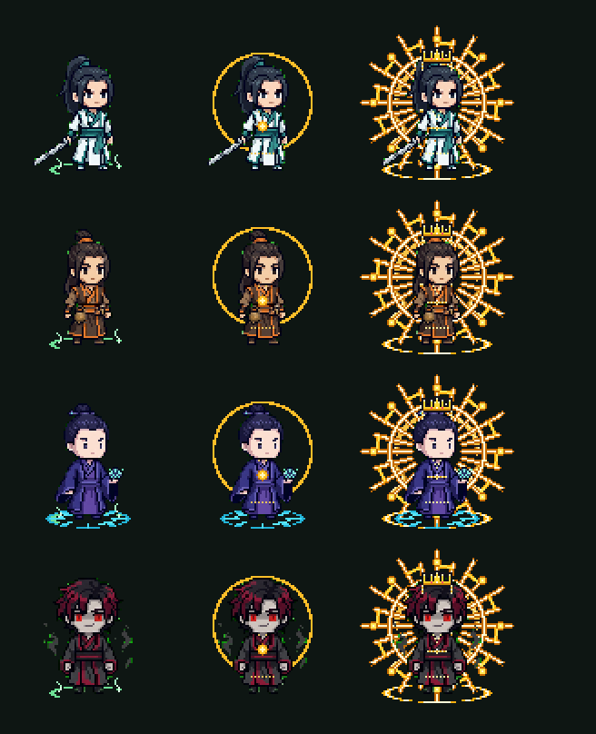
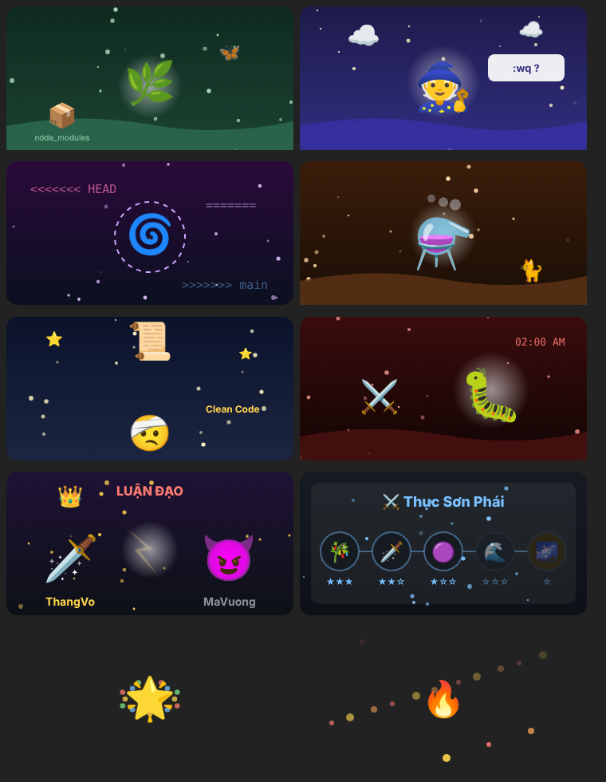
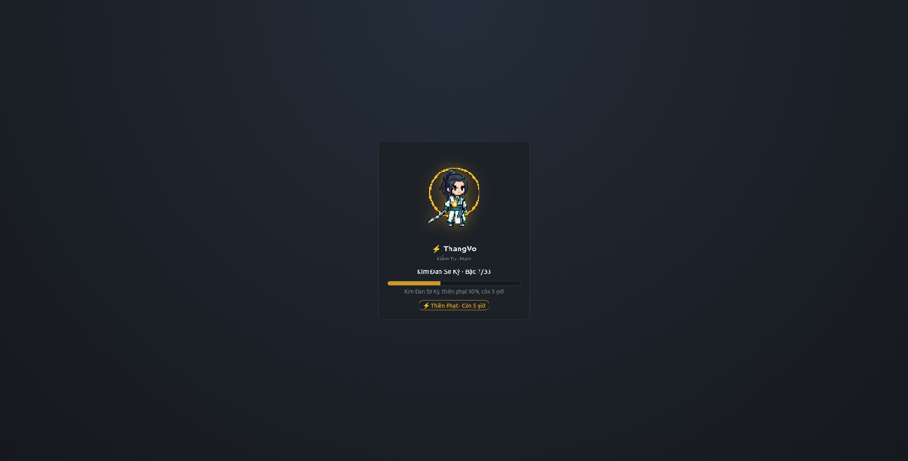

<div align="center">

# ⚔️ Tu Tiên Ký

**Mini game tu tiên chạy ngay trong Claude Code.**
Mỗi token bạn dùng để chat với Claude là một hơi linh khí. Tu đủ thì đột phá, gặp thiên phạt, đánh Tâm Ma, và leo lên 33 cảnh giới.




</div>

---

## 📜 Câu chuyện

> Ba giờ sáng. Một coder đang vibe code dự án thứ 101 trong tuần. Hắn gõ "làm cho nó chạy đi", AI đáp "Được rồi!", và hắn tin thật. Rồi sét đánh trúng laptop.
>
> Mở mắt ra, hắn đứng giữa một thung lũng toàn dòng chữ phát sáng. Muốn trở lại làm người, hắn phải tu luyện: **hấp thu token** từ những con AI mình từng dùng, và đi đến cảnh giới cao nhất.

---

## 🚀 Cài đặt

**Cách 1: từ marketplace** (khuyên dùng)

```text
/plugin marketplace add thangvofastboy/tutien
/plugin install tutien@tutien
/reload-plugins
```

Dòng đầu thêm repo này làm marketplace tên `tutien` (đọc từ `.claude-plugin/marketplace.json`). Dòng thứ hai cài plugin `tutien` từ marketplace đó.

**Cách 2: từ bản clone git** (để `/tutien update` tự chuyển sang tag mới)

```sh
git clone git@github.com:thangvofastboy/tutien.git ~/.claude/tutien
claude plugin marketplace add ~/.claude/tutien
claude plugin install tutien@tutien
```

> [!NOTE]
> Bản clone đứng ở detached HEAD sau mỗi lần cập nhật. Muốn sửa code thì dùng một bản checkout khác.

---

## 🎮 Bắt đầu trong 1 phút

```text
/tutien start
```

Wizard 7 bước sẽ dẫn bạn qua: 📖 lời mở đầu → 🎭 chọn lớp → ⚥ chọn giới → ✍️ đặt đạo hiệu → 💬 chọn tính cách → 🖼️ cách hiển thị → 📋 ghi danh.

Xong là chat bình thường với Claude. EXP tự cộng sau mỗi lượt.

---

## 🧭 Lệnh

| Lệnh | Việc làm |
|---|---|
| 🌱 `/tutien start` · `batdau` | Wizard tạo nhân vật, có câu chuyện chạy chữ |
| ✍️ `/tutien ten <đạo hiệu>` | Đặt tên trong wizard khi dùng app điện thoại |
| 📝 `/tutien register <tên> <lớp> <giới>` | Ghi danh nhanh bằng một dòng |
| 📊 `/tutien status` · `s` | Cảnh giới, tiến độ, thiên phạt |
| 🏆 `/tutien top` · `t` | 5 bảng xếp hạng, có hàng của bạn nếu ngoài top 10 |
| 🖼️ `/tutien panel` | Mở panel nhân vật |
| ⚙️ `/tutien setting` · `caidat` | Pane cài đặt |
| 🌐 `/tutien web` · `web stop` | Trang nhân vật trên trình duyệt (127.0.0.1:7340) |
| 🎨 `/tutien hienthi image\|raster\|text` | Cách vẽ nhân vật trong pane |
| 🗣️ `/tutien persona <tên>` | Tính cách nhân vật |
| 📚 `/tutien truyen` | Đọc các chương truyện đã mở |
| 👗 `/tutien appearance <lớp> <giới>` | Đổi lớp và giới |
| ♻️ `/tutien reset confirm <lớp> <giới>` | Làm lại từ bậc 1 |
| 🔑 `/tutien khoa-moi` | Đổi khóa bí mật |
| ⬆️ `/tutien update` | Cập nhật bản đã ký mới nhất rồi nạp lại plugin |
| 📊 `/tutien history` · `h` | Biểu đồ 14 ngày và nhật ký tuần |
| 🔎 `/tutien tim <tên>` | Xem hồ sơ một đạo hữu |
| 🌏 `/tutien team` | Tiến độ toàn team, sự kiện Thiên Đạo, lễ hội sắp tới |
| 📚 `/tutien thu-vien` | Pháp bảo, đan, chức vụ, huy hiệu, chợ (✅ là đã có) |
| 🏯 `/tutien tong tao\|vao <tên>` · `roi` · `xem` · `bo-nhiem <tên> <chức vụ>` | Tông môn |
| 🤝 `/tutien ban <tên>` · `chap-nhan` · `huy` | Bạn đồng hành |
| 💞 `/tutien dao-lu <tên>` · `chap-nhan` · `huy` | Đạo lữ |
| 🎉 `/tutien chuc-mung <tên>` | Chúc mừng người vừa đột phá |
| 🌀 `/tutien bicanh` | Ghi danh bí cảnh tháng (ngày 1–2) |
| ⚗️ `/tutien luyen-dan <loại>` · `uong-dan <loại>` | Luyện và uống đan |
| 🧘 `/tutien be-quan <ngày>` · `be-quan xuat-quan` | Bế quan tối đa 14 ngày |
| 🛍️ `/tutien cho` · `mua <món>` · `trang-bi <món>` · `doi-phap-bao <loại>` | Chợ phường thị |
| 🔗 `/tutien lien-ket` · `dang-nhap <tên> <mã>` | Dùng chung nhân vật trên máy khác |
| 🎲 `/tutien ky-ngo [a\|b]` | Xem và chọn kỳ ngộ (cũng bấm được trong panel) |
| 🌈 `/tutien linh-can` | Linh căn ngũ hành theo phong cách code |
| ⚔️ `/tutien luan-dao <tên>` | Luận đạo với đạo hữu khác, 3 trận mỗi ngày |
| 🔥 `/tutien chuoi` | Chuỗi ngày tu luyện và mốc thưởng |
| 📖 `/tutien cong-phap [hoc <id> \| tay-tuy]` | Cây công pháp |
| 🏯 `/tutien tong-chien` | Tông chiến tuần, Linh Mạch, Thiên Kiếp Đồng Tâm |
| 🧑‍🏫 `/tutien bai-su <tên>` · `nhan-do <tên>` · `su-do [huy]` | Sư đồ |
| 🪪 `/tutien the` | Thẻ khoe nhân vật (file SVG trong thư mục đang làm việc) |
| 📜 `/tutien truyen-tuan` | Truyện tu tiên tuần này, do Claude chấp bút |
| ✍️ `/tutien doi-ten <tên mới>` | Đổi tên nhân vật (7 ngày một lần) |
| ❓ `/tutien help` | Danh sách lệnh |

---

## 🌿 Luật tu luyện

```diff
+ 1.000 token = 1 EXP  (input + output + cache write; không tính cache read)
+ Đủ EXP của bậc  →  ⚡ Thiên Phạt: góp đủ token trước hạn
+ Vượt thiên phạt →  ✨ Đột Phá, lên bậc kế; 20% nhận pháp bảo khi sang đại cảnh giới mới
- Quá hạn         →  🌧️ EXP về 0, giữ nguyên bậc
- 2% mỗi lần đột phá → 💀 Đan Điền Vỡ, về Luyện Khí Sơ Kỳ
```

**11 đại cảnh giới × Sơ / Trung / Hậu Kỳ = 33 bậc**

🟢 Luyện Khí → 🟢 Trúc Cơ → 🟡 Kim Đan → 🟣 Nguyên Anh → 🟠 Hóa Thần → 🟣 Luyện Hư → 🔵 Hợp Thể → 🌸 Đại Thừa → ⚡ Độ Kiếp → ☀️ Chân Tiên → 👑 Tiên Đế

Đường tu được thiết kế cho mức đỉnh 20 triệu token mỗi ngày: ở mức đó mất khoảng 4,6 năm để đạt Tiên Đế Hậu Kỳ. Người chơi chỉ thấy phần trăm, không thấy con số thô.

### 🎭 Bảy lớp

| Lớp | Bonus |
|---|---|
| 🗡️ Kiếm Tu | +3% EXP |
| ⚗️ Đan Sư | Thiên phạt cần ít hơn 5% token |
| 🧭 Trận Pháp Sư | Cửa sổ thiên phạt dài thêm 12 giờ |
| 🔨 Luyện Khí Sư | Trượt thiên phạt vẫn giữ 15% EXP |
| 📜 Phù Tu | Tỷ lệ tử vong 1,75% |
| 👊 Thể Tu | Sau khi trượt, thiên phạt kế tiếp nhẹ hơn 10% |
| 👹 Ma Tu | +5% EXP, nhưng tử vong 2,5% |

### 👹 Tâm Ma Trễ Deadline

Thỉnh thoảng sau một lượt chat, Tâm Ma hiện ra: 2% lúc bình thường, 10% khi đang thiên phạt, 20% khi thiên phạt sắp hết giờ.

- 🗡️ **Xua đuổi**: dùng đủ token trong 2 giờ (khoảng 90% lượng bạn hay dùng trong 2 giờ) → **+5 linh thạch**.
- 😈 **Thất bại**: mất 2% token đã góp cho thiên phạt, hoặc 0,5% ngưỡng EXP. Tối đa một lần mỗi ngày.
- 🔕 Tắt "Hiệu ứng" trong `/tutien setting` thì Tâm Ma không xuất hiện.

---

## 🏯 Tu cùng đồng môn

- **Tông môn**: lập tông cần bậc 10, tối đa 10 người. Tông Chủ bổ nhiệm Phó Tông Chủ, Trưởng Lão, Hộ Pháp, Chân Truyền Đệ Tử, mỗi chức vụ có bonus nhỏ. Mỗi tuần cả tông cần 2 triệu token × số người, mỗi người ít nhất 400.000; tuần trước không đạt thì bonus chức vụ tạm dừng. Người không ở tông nào (tán tu) được +0,5% EXP.
- **Bạn đồng hành**: hai người cùng tu trong 24 giờ thì mỗi người +0,5% EXP.
- **Đạo lữ**: nhận 2% EXP từ mỗi lượt của người kia, tối đa 20.000 EXP mỗi ngày.
- **Mùa**: mỗi quý một mùa; người đứng đầu bảng Tu vi mang danh hiệu 👑 Quán Quân trong mùa kế.
- **Thử thách cộng đồng**: cả team đạt 100 triệu token trong tháng thì tháng sau có bộ thoại đặc biệt.
- **Thiên Đạo Khoan Dung**: thứ Bảy và Chủ nhật, thiên phạt mới cần ít hơn 10% token.

## 🎒 Hằng ngày và hằng tháng

- 📅 **Nhiệm vụ ngày**: 500.000 token trong ngày. Đủ 10 ngày thì nhận một pháp bảo.
- 🌀 **Bí cảnh tháng**: ghi danh ngày 1–2, ngày 1–7 mỗi ngày 1 triệu token, thưởng pháp bảo hiếm.
- 🎊 **Bí cảnh lễ hội**: Tết, Giỗ Tổ, 30/4–1/5, 19/5, 17/6, 27/7, Quốc khánh. Tổng 3 triệu × số ngày, không cần ghi danh.
- ⚗️ **Đan dược**: Hộ Thể (nửa tỷ lệ chết lần đột phá kế), Tốc Tu (+10% EXP 24 giờ), Thông Thiên (−10% thiên phạt kế).
- 🗼 **Tháp Thử Luyện**: tầng k ứng với bậc 3k+1, có bảng xếp hạng riêng.
- 🏅 **11 huy hiệu**, 💎 **linh thạch** từ Tâm Ma và pháp bảo vượt trần, đổi lấy đồ trang trí ở chợ.

## 🎲 Cơ duyên và đồng môn

- 🌈 **Linh căn**: mod đếm loại việc đạo hữu làm qua mỗi lần Claude sửa file hay chạy lệnh (chỉ đếm đuôi file, không đọc nội dung). Sau 20 lần, linh căn thức tỉnh: 🗡️ Kim (code: +0,5% EXP), 💧 Thủy (Python, dữ liệu: −1% token thiên phạt), 🔥 Hỏa (terminal: kỳ ngộ thường hơn), ⛰️ Thổ (test: −0,05% tử vong), 🌿 Mộc (tài liệu, giao diện: linh thạch kỳ ngộ ×1,5).
- 🎲 **Kỳ ngộ**: sau mỗi lượt có ~3% gặp chuyện lạ (tối đa 3 lần mỗi ngày): tiền bối hỏi cách thoát Vim, ảo cảnh merge conflict, yêu thú bug production… Chọn 🅰️ hoặc 🅱️ ngay trong panel. Có thể được EXP, linh thạch, pháp bảo, đan dược, hoặc mất chút linh thạch. Kỳ ngộ tan sau 24 giờ.
- ⚔️ **Luận đạo**: thách đấu đạo hữu khác. Sức mạnh theo bậc, pháp bảo, may mắn, và ngũ hành tương khắc. Thắng +5 linh thạch, thua không mất gì; người bị thách thua thì được 2 linh thạch phí chỉ giáo.
- 🔥 **Chuỗi ngày**: 3 ngày +5 linh thạch, 7 ngày +1 pháp bảo, 14 ngày +20 linh thạch, 30 ngày +1 pháp bảo hiếm, 100 ngày huy hiệu Đạo Tâm Bất Diệt. Đứt chuỗi thì các mốc mở lại.
- 📖 **Công pháp**: mỗi lớp một môn phái, một cây riêng: 4 công pháp 3 tầng và 1 **tuyệt kỹ** (mở khi đã tu 6 tầng). Mỗi lần đột phá được 1 điểm (người chơi cũ nhận sẵn điểm theo bậc). Bấm nút "Học" ngay trong panel. Đổi lớp thì công pháp lớp cũ được hoàn điểm. Tẩy tủy hoàn điểm, tốn 20 linh thạch.

  Tên môn phái và công pháp mượn từ các truyện tu tiên, kiếm hiệp nổi tiếng (ghi xuất xứ trong game); hiệu lực là của riêng Tu Tiên Ký.

  | Lớp | Môn phái | Công pháp | Tuyệt kỹ | Thế mạnh |
  |---|---|---|---|---|
  | 🗡️ Kiếm Tu | Thục Sơn Phái (Thục Sơn Kiếm Hiệp) | Thanh Trúc Phong Vân Kiếm, Độc Cô Cửu Kiếm, Tử Hà Thần Công, Lăng Ba Vi Bộ | 🌌 Lục Mạch Thần Kiếm | EXP, luận đạo |
  | ⚗️ Đan Sư | Hoàng Phong Cốc (Phàm Nhân Tu Tiên) | Thanh Liên Địa Tâm Hỏa, Chưởng Thiên Bình, Trúc Cơ Đan, Trường Xuân Công | 🏺 Hư Thiên Đỉnh | thiên phạt nhẹ, linh thạch |
  | 🔯 Trận Pháp Sư | Thanh Vân Môn (Tru Tiên) | Thái Cực Huyền Thanh Đạo, Đại Phạn Bát Nhã, Phệ Huyết Châu, Thần Kiếm Ngự Lôi Chân Quyết | ✨ Tru Tiên Kiếm Trận | phòng thủ, thiên phạt |
  | 🔨 Luyện Khí Sư | Minh Giáo (Ỷ Thiên Đồ Long Ký) | Huyền Thiết Trọng Kiếm, Càn Khôn Đại Na Di, Thánh Hỏa Lệnh, Cửu Dương Thần Công | 🐉 Ỷ Thiên Kiếm · Đồ Long Đao | linh thạch, luận đạo |
  | 📜 Phù Tu | Thất Huyết Đồng (Quang Âm Chi Ngoại) | Độc Đan, Thần Linh Tàn Diện, Tử Sắc Thủy Tinh, Hải Sơn Quyết | 🌠 Cấm Chế Chi Đạo (Tiên Nghịch) | kỳ ngộ |
  | 💪 Thể Tu | Tàn Lão Thôn (Mục Thần Ký) | Bá Thể Tam Đan Công, Hàng Long Thập Bát Chưởng, Kim Chung Tráo, Long Tượng Bát Nhã Công | 🌟 Hoang Cổ Thánh Thể (Già Thiên) | ít tử vong, chịu thiên phạt |
  | 😈 Ma Tu | Nhật Nguyệt Thần Giáo (Tiếu Ngạo Giang Hồ) | Hấp Tinh Đại Pháp, Hóa Công Đại Pháp, Cửu Âm Bạch Cốt Trảo, Quỳ Hoa Bảo Điển | 💀 Đại Dục Thiên Ma Kinh (Mục Thần Ký) | EXP cao nhất |
- 🏯 **Tông chiến**: tông có từ 2 người thi tổng token tuần. Tông thắng tuần trước giữ ⛲ Linh Mạch: cả tông +0,5% EXP.
- ☄️ **Thiên Kiếp Đồng Tâm**: cả team đạt mốc token tuần (3 triệu mỗi người, ít nhất 10 triệu) thì ai cũng +1% EXP đến hết tuần.
- 🧑‍🏫 **Sư đồ**: bái sư người từ bậc 7, cao hơn mình 3 bậc. Đồ đệ +0,5% EXP; mỗi lần đồ đệ đột phá, sư phụ +5 linh thạch. Mỗi sư phụ tối đa 3 đồ đệ.
- 🪪 **Thẻ khoe**: `/tutien the` in một thẻ SVG có ảnh, cảnh giới, linh căn, chuỗi ngày; hiện luôn trong panel.
- 📜 **Truyện tuần**: Claude (Haiku) viết một đoạn truyện hài về tuần tu luyện của đạo hữu, theo tính cách nhân vật. Mỗi tuần lưu một bản; `/tutien truyen-tuan moi` để viết lại.

### 🎨 Hình ảnh và hiệu ứng

Desktop, web và điện thoại vẽ hình SVG có hoạt ảnh: mỗi kỳ ngộ một cảnh, cảnh luận đạo hai bên đối đầu, cuộn công pháp của môn phái. Mỗi sự kiện (kỳ ngộ, chuỗi ngày, lĩnh ngộ công pháp, tuyệt kỹ, luận đạo thắng thua, Thiên Kiếp Đồng Tâm, pháp bảo, huy hiệu) có băng rôn và khung hạt bay chạy theo nhịp. Terminal hiện tranh chữ và dòng hiệu ứng chạy chữ. Tắt hết bằng "Hiệu ứng" trong `/tutien setting`.



## 🔗 Dùng trên nhiều máy

Nhân vật gắn với tài khoản Claude của máy tạo ra nó (mod đọc `oauthAccount.accountUuid` trong `~/.claude.json`, chỉ gửi mã này, không gửi email).

1. Trên máy đang có nhân vật: `/tutien lien-ket` → nhận mã 8 ký tự, hết hạn sau 24 giờ, dùng một lần.
2. Trên máy kia, **cùng tài khoản Claude**: `/tutien dang-nhap <tên> <mã>`.

Nếu máy kia đã có nhân vật riêng (cùng tài khoản Claude), `dang-nhap` gộp hết vào nhân vật chính: cộng EXP tích lũy, linh thạch, pháp bảo, huy hiệu, đồ và token, rồi **xóa nhân vật cũ**. Nếu nhân vật chính đang thiên phạt thì EXP chỉ cộng tới trần của bậc hiện tại, không nhảy bậc. Tông, bạn tu và đan dược của nhân vật cũ không chuyển sang.

Máy đăng nhập tài khoản Claude khác sẽ bị từ chối. `/tutien khoa-moi` đổi khóa và đăng xuất mọi máy khác.

## 🗣️ Claude nói theo tính cách nhân vật

Bật "Claude nói theo tính cách nhân vật" trong `/tutien setting`: tính cách (persona) của nhân vật được thêm vào system prompt, Claude đổi giọng điệu cho vui. Nội dung kỹ thuật và độ chính xác giữ nguyên.

## 🖥️ Hiển thị trên từng nền tảng

| | Terminal | Desktop app | Điện thoại | Web |
|---|:---:|:---:|:---:|:---:|
| 🖼️ Pane nhân vật | ✅ ô màu hoặc ảnh | ✅ ảnh (Svg) | ✅ ảnh (Svg) | ⚪ |
| 🧭 Wizard `/tutien start` | ✅ | ✅ | ✅ nút bấm + `/tutien ten` | ⚪ |
| ⚙️ Cài đặt | ✅ ô chọn | ✅ ô chọn | ✅ nút bấm | ⚪ |
| 💬 Lời chào và thông báo trong khung chat | ✅ | ✅ | ✅ | ⚪ |
| 📌 Khung nhỏ trên ô nhập | ✅ | ✅ | ❌ app chưa có | ⚪ |
| 📏 Dòng trạng thái | ✅ | ⚪ | ⚪ | ⚪ |
| 🏆 Bảng xếp hạng trong pane | ⚪ | ✅ | ⚪ | ⚪ |
| ⌨️ Mọi lệnh `/tutien` | ✅ | ✅ | ✅ | ✅ |

✅ đã kiểm tra bằng test của engine · ⚪ chưa kiểm tra riêng · ❌ nền tảng chưa hỗ trợ

### 💬 Trong khung chat

Mở phiên mới, mod viết vài dòng chào giống Claude Code:

```text
🙏 Chào buổi sáng, ThangVo
🌿 Kim Đan Sơ Kỳ: 42% tiến độ
💡 Mẹo: /tutien top để xem ai đang dẫn đầu tông môn.
🔮 Thiên Cơ Hôm Nay: Hôm nay hợp refactor, kỵ force push.
```

Khi có sự kiện, mod viết thêm một dòng như `⚡ Thiên Phạt Giáng Xuống!` hay `✨ Đột Phá Thành Công!`. Các dòng này không gửi cho Claude.

### 📌 Khung nhỏ và dòng trạng thái

```text
                                  ╭──────────────────────────╮
                                  │ 🗡️ ThangVo · Kiếm Tu      │
                                  │ ⚡ Kim Đan Sơ Kỳ · còn 5 giờ │
                                  ╰──────────────────────────╯
```

Dòng thứ hai đổi màu: 🟢 đang tu, 🟡 thiên phạt còn dưới 12 giờ, 🔴 còn dưới 1 giờ.

### 🌐 Trang web mini



`/tutien web` chạy `node web/server.js` trên máy bạn, chỉ nghe ở `127.0.0.1:7340`, kèm bảng Tu vi. Cần có `node` trong PATH.

### 🌍 Trang web của team

Server cũng có trang web chỉ để xem: `/` tổng quan, `/top` mọi bảng xếp hạng, `/p/<tên>` hồ sơ, `/tong/<tên>` tông môn, `/thu-vien`, `/truyen`. Trang không hiện số EXP hay token.

> [!IMPORTANT]
> Bật Cloudflare Access cho tên miền Worker để chỉ thành viên team xem được (cấu hình trên Cloudflare, không nằm trong code).

---

## ⚙️ Cài đặt (`/tutien setting`)

| Mục | Lựa chọn |
|---|---|
| 🎨 Cách vẽ nhân vật | Ô màu (mọi terminal) · Ảnh (kitty, WezTerm) · Chỉ chữ |
| 📏 Dòng trạng thái dưới ô nhập | Bật · Tắt |
| 📌 Khung nhỏ phía trên ô nhập | Bật · Tắt |
| 💬 Lời chào và thông báo trong khung chat | Bật · Tắt |
| ⚡ Hiệu ứng thiên phạt và hào quang | Bật · Tắt |
| 🖌️ Màu nền panel nhân vật | Theo terminal · Mực đen · Xanh đêm · Ngọc lục · Giấy vàng |
| ⬆️ Tự cập nhật khi mở Claude Code | Bật · Tắt |
| 🗣️ Tính cách nhân vật | Không · 7 persona |

Thay đổi được lưu ngay trên máy.

---

## 🛡️ Bảo mật và công bằng

- 🔑 Server chỉ lưu SHA-256 của khóa. Khóa nằm trên máy bạn.
- 🚫 Mỗi lượt tối đa 5 triệu token (vượt là bị từ chối cả lượt), mỗi giờ 10 triệu, mỗi ngày 40 triệu.
- 🕵️ Lượt bất thường bị cộng điểm nghi ngờ. Từ 10 điểm thì bị ẩn khỏi bảng xếp hạng.
- ✍️ Mỗi bản phát hành là một tag ký SSH. `/tutien update` kiểm tra chữ ký và không cho hạ phiên bản.
- 🧩 Server chỉ nhận hai bản phát hành gần nhất.

---

## 🧑‍💻 Phát triển

```sh
claude plugin validate .          # kiểm tra manifest và module
claude plugin test .              # test của mod (terminal, desktop, mobile)
claude --plugin-dir .             # thử trong một phiên
cd server && npm test             # test luật trên server
cd server && npx wrangler deploy  # deploy Cloudflare Worker
```

<details>
<summary>📁 Cấu trúc thư mục</summary>

```text
.claude-plugin/   plugin.json, marketplace.json
hooks/            module của mod: luật, pane, lệnh, khung chat, Tâm Ma
server/           Cloudflare Worker + Durable Objects
web/              server Node cho /tutien web
assets/           ảnh 7 lớp × 2 giới × 33 bậc, Tâm Ma, ô màu
scripts/          nhập ảnh, xóa nền, sinh ô màu
docs/             spec, plan, tài liệu vẽ ảnh
```

</details>

### 📦 Phát hành

1. Tăng `version` trong `.claude-plugin/plugin.json` (ví dụ `0.1.3` → `0.1.4`).
2. Merge vào `main`. Workflow `.github/workflows/tag.yml` tạo và ký tag `v<version>`.
3. Đăng ký tag lên server (server chỉ nhận hai bản mới nhất):

   ```sh
   read -s "T?ADMIN_TOKEN: " && echo && curl -s -X POST https://tutien.thang-vo.workers.dev/admin/releases \
     -H "authorization: Bearer $T" -H "content-type: application/json" -d '{"tag":"v<version>"}'; unset T
   ```

4. Người chơi chạy `/tutien update` (hoặc `/plugin update tutien` rồi `/reload-plugins`).

<div align="center">

🌸 *Tu tiên giống lập trình: viết ít thôi, nhưng phải chạy được.* 🌸

</div>
